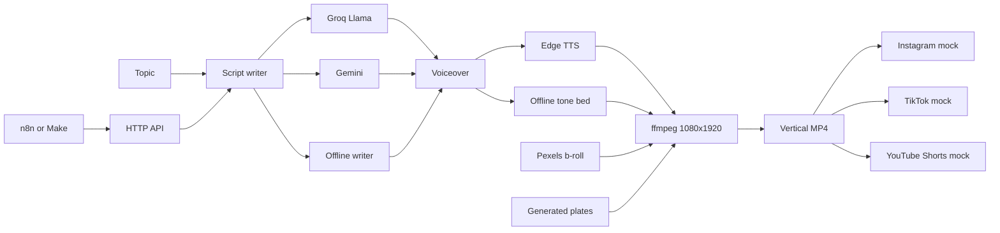

# AI Shorts Video Pipeline

Portfolio demo by [Mustafa](https://github.com/mustafaautomation). It is not client work and it does not post to a real account.

Give it a topic. It writes a 30–45 second script, speaks it, burns word-synced captions onto a 1080×1920 reel, and records the exact Instagram Reels, TikTok, and YouTube Shorts requests it would send. Those requests are saved as JSON. Nothing is uploaded.


The clip above is the opening of [docs/demo-reel.mp4](docs/demo-reel.mp4). That file was rendered with Edge TTS. The script clock for it is about 30 seconds; Aria reads it in about 26. CI renders the same shape of reel with the offline voice so the build does not depend on Microsoft.

## Architecture



Script order is Groq, then Gemini, then a deterministic offline writer. Voice order is Edge TTS, then a local tone bed that still has a word clock. Pictures come from Pexels when `PEXELS_API_KEY` is set, and from generated gradient plates otherwise. Publish adapters always stop before the network unless you explicitly turn dry-run off, and even then they refuse instead of posting.

## Quickstart

Python 3.11+, ffmpeg, and the DejaVu fonts.

```bash
python -m venv .venv
source .venv/bin/activate
pip install -e ".[dev]"
cp .env.example .env

shorts-pipeline doctor
shorts-pipeline script --topic "How to explain a hard idea in 30 seconds"
shorts-pipeline run \
  --topic "How to explain a hard idea in 30 seconds" \
  --script-provider offline \
  --voice-provider offline \
  --publish \
  --out out/reel.mp4
```

`--publish` writes three JSON receipts under `out/publish/`. Open one. The body is the request a live client would send, with any token redacted.

```bash
shorts-pipeline serve
curl -s localhost:8080/v1/script \
  -H 'content-type: application/json' \
  -d '{"topic":"desk stretches"}'
```

`POST /v1/pipeline` renders a reel. It defaults to the offline voice so a caller is not surprised by a Microsoft round-trip. Pass `"voice_provider": "edge"` when you want spoken audio. `dry_run: false` returns HTTP 409 and does not post.

Interactive docs live at `http://127.0.0.1:8080/docs`.

## Environment

Copy `.env.example`. Every key is optional.

| Variable | Role |
| --- | --- |
| `SCRIPT_PROVIDER` | `auto`, `groq`, `gemini`, or `offline` |
| `GROQ_API_KEY`, `GROQ_MODEL` | Groq OpenAI-compatible chat. Default model `llama-3.3-70b-versatile` |
| `GEMINI_API_KEY` or `GOOGLE_API_KEY`, `GEMINI_MODEL` | Gemini generateContent. Default model `gemini-2.0-flash` |
| `VOICE_PROVIDER` | `auto`, `edge`, or `offline` |
| `EDGE_TTS_VOICE` | Default `en-US-AriaNeural` |
| `PEXELS_API_KEY` | Portrait b-roll. Empty means generated plates |
| `OUTPUT_DIR` | Renders and mock receipts. Default `out` |
| `PUBLISH_DRY_RUN` | Default `true` |
| `INSTAGRAM_ACCESS_TOKEN`, `INSTAGRAM_USER_ID` | Reserved for a future Graph API client. Redacted in receipts |
| `TIKTOK_ACCESS_TOKEN` | Reserved for the Content Posting API |
| `YOUTUBE_CLIENT_ID`, `YOUTUBE_CLIENT_SECRET`, `YOUTUBE_REFRESH_TOKEN` | Reserved for `videos.insert` |
| `SHORTS_API_BASE` | Base URL the blueprints call |

No secret belongs in git. `.env` is ignored.

## What is real, and what is mocked

Real, and free:

- Groq and Gemini when you supply a key. A bad response falls through to the next writer.
- The offline writer, which is what tests and CI use. The same topic always yields the same words, with a hook, two to four beats, and a CTA inside 30–45 seconds on the pipeline clock.
- Edge TTS word boundaries, when the machine can reach Microsoft.
- The offline tone bed, which writes a WAV and a matching word clock so caption tests and CI still produce a reel with an audio stream.
- ffmpeg output: H.264, AAC, 1080×1920, burned-in ASS captions. The active word is highlighted. Section labels sit above a kinetic line.
- Pexels portrait clips when a key is present. A failed download falls back to generated plates.

Mocked:

- Instagram Reels (`POST /{ig-user-id}/media` then `media_publish`).
- TikTok (`POST /v2/post/publish/video/init/`).
- YouTube Shorts (`videos.insert`, private, `#Shorts` in the description).
- An optional `scheduled_at` timestamp is stored on the payload and never sent.

`shorts-pipeline run --no-dry-run` and `dry_run: false` raise `RealPublishDisabled` before any socket opens. Wiring a live client is a later change, and it should wait for Mustafa to approve the accounts.

## Blueprints

Both blueprints call `POST {SHORTS_API_BASE}/v1/pipeline` with `publish: true` and `dry_run: true`.

- [blueprints/n8n-shorts-pipeline.json](blueprints/n8n-shorts-pipeline.json) — import in n8n, set `SHORTS_API_BASE`, then POST `{ "topic": "..." }` to the webhook.
- [blueprints/make-shorts-scenario.json](blueprints/make-shorts-scenario.json) — import as a Make scenario blueprint. Create a scenario variable `shorts_api_base`.

Start the API first: `shorts-pipeline serve`.

The same job from a shell is `shorts-pipeline run --topic "..." --publish`.

## Tests

```bash
pytest
ruff check src tests
ruff format --check src tests
```

The suite checks the script rubric, caption times against the word clock, sentence breaks, mock payload shape and redaction, the refusal to go live, blueprint JSON, and an ffprobe pass over a rendered MP4 (1080×1920, H.264, AAC, duration in the script window).

GitHub Actions runs that suite, then renders `out/sample-reel.mp4` with no API keys and uploads the reel plus the mock receipts as artifacts. A second job builds the web demo.

## Web demo

The site in [`web/`](web/) is the piece intended for `shorts.quvantic.com`. It writes a script in the browser session (Groq, then Gemini, then the same offline writer) and can speak it with the Web Speech API. The phone plays the pre-rendered sample. It does not run ffmpeg.

```bash
cd web
npm install
npm run build
npm start
```

Deploy on Vercel:

1. Import `mustafaautomation/ai-shorts-video-pipeline`.
2. Set the root directory to `web`. Framework preset is Next.js. Install and build commands can stay at the defaults.
3. Optional env for live writing: `GROQ_API_KEY`, `GEMINI_API_KEY`, `GROQ_MODEL`, `GEMINI_MODEL`. With none of them, the offline writer still answers.
4. Deploy.

DNS for `shorts.quvantic.com` is not configured here. After the deployment exists, add the domain in the Vercel project and point the name with the records Vercel shows. That step is Mustafa's.

## Layout

```
src/shorts_pipeline/   script, voice, captions, ffmpeg, mock publishers, API, CLI
tests/                 rubric, timing, render, publish, API, blueprints
blueprints/            n8n workflow and Make scenario
web/                   Next.js demo
docs/demo-reel.mp4     sample vertical reel
docs/demo-reel.gif     short preview embedded above
```
