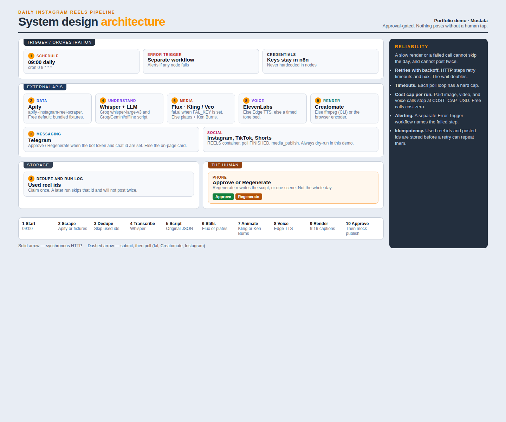
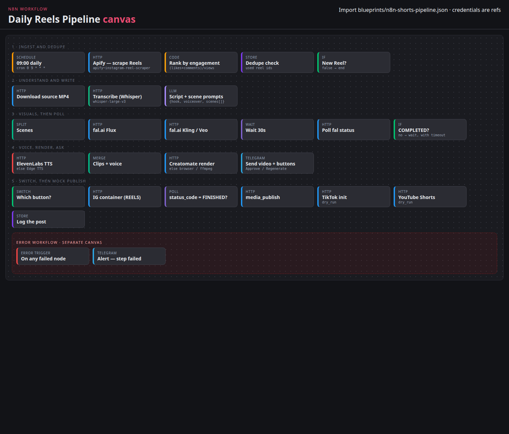
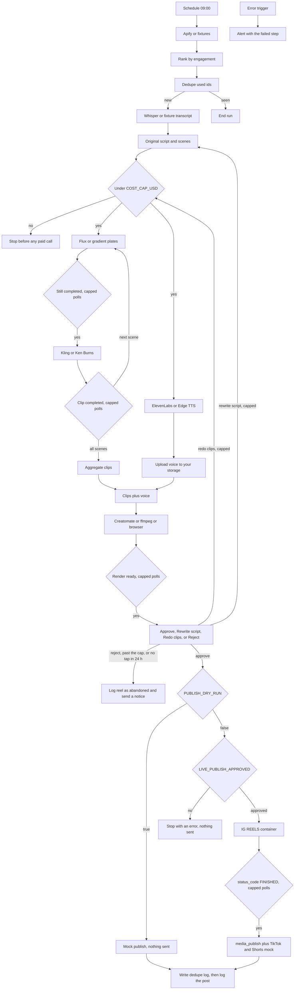

# AI Shorts Video Pipeline

Portfolio demo by [Mustafa](https://github.com/mustafaautomation). One original Reel a day, and nothing posts without a human tap. Not client work.


[Download the vertical MP4](docs/demo-reel.mp4). GitHub shows the GIF above. The MP4 is the file.





## Free path vs keys

| Stage | Free default | Named provider, only if the key is set |
| --- | --- | --- |
| Scrape | Bundled sample reels | `APIFY_TOKEN` → `apify~instagram-reel-scraper` |
| Dedupe | Local used-id store | same store |
| Transcribe | Fixture transcript | `GROQ_API_KEY` → whisper-large-v3, or `OPENAI_API_KEY` → whisper-1 |
| Script | Offline writer, original JSON | Groq, then Gemini |
| Stills | Gradient plates | `FAL_KEY` → Flux |
| Motion | Ken Burns | `FAL_KEY` → Kling, or `FAL_VIDEO_MODEL=veo` |
| Voice | Edge TTS, else a timed tone bed | `ELEVENLABS_API_KEY` |
| Render | Browser encoder on the site, ffmpeg in the CLI | `CREATOMATE_API_KEY` |
| Approval | On-page Approve / Regenerate | `TELEGRAM_BOT_TOKEN` + `TELEGRAM_CHAT_ID` |
| Publish | Mock IG REELS + TikTok + YouTube payloads | Still mock until a live client is approved |

`COST_CAP_USD` stops paid calls. Free calls cost zero.

## Quickstart

Python 3.11+, ffmpeg, and the DejaVu fonts.

```bash
python -m venv .venv && source .venv/bin/activate
pip install -e ".[dev]"
shorts-pipeline run --topic "How to explain a hard idea" --script-provider offline --voice-provider offline --publish --out out/reel.mp4
```

The site in `web/` is what Vercel builds. Set the project root to `web`. It does not call Python or ffmpeg.

```bash
cd web && npm install && npm run build && npm start
```

## Web render vs CLI render

The CLI (`shorts-pipeline run`) uses ffmpeg on the machine: Edge TTS or the offline tone bed, ASS captions, 1080×1920 H.264. CI uses that path with no keys and uploads the MP4.

The website encodes the MP4 in the browser with WebCodecs (H.264 + AAC) after `/api/voice` returns speech. Captions are burned into the frames. Ken Burns plates stand in for paid image-to-video. Approve shows the mock Instagram, TikTok, and YouTube payloads. Regenerate script rewrites only the words. Regenerate scene 2 redraws only that scene.

## Architecture



Sync calls return immediately. The Flux still, the Kling or Veo clip, the Creatomate render, and the Instagram container are each submit, wait, poll, and check. Every one of those loops counts its polls and stops with a named error when the count runs out, which fires the error workflow. Every HTTP step retries three times. The full page is [docs/architecture.html](docs/architecture.html). The n8n import is [blueprints/n8n-shorts-pipeline.json](blueprints/n8n-shorts-pipeline.json) and the error workflow is [blueprints/n8n-error-workflow.json](blueprints/n8n-error-workflow.json).

## CLI details

Python 3.11+, ffmpeg, and the DejaVu fonts.

```bash
python -m venv .venv
source .venv/bin/activate
pip install -e ".[dev]"
cp .env.example .env

shorts-pipeline doctor
shorts-pipeline script --topic "How to explain a hard idea in 30 seconds"
shorts-pipeline run \
  --topic "How to explain a hard idea in 30 seconds" \
  --script-provider offline \
  --voice-provider offline \
  --publish \
  --out out/reel.mp4
```

`--publish` writes three JSON receipts under `out/publish/`. Open one. The body is the request a live client would send, with any token redacted.

```bash
shorts-pipeline serve
curl -s localhost:8080/v1/script \
  -H 'content-type: application/json' \
  -d '{"topic":"desk stretches"}'
```

`POST /v1/pipeline` renders a reel. It defaults to the offline voice so a caller is not surprised by a Microsoft round-trip. Pass `"voice_provider": "edge"` when you want spoken audio. `dry_run: false` returns HTTP 409 and does not post.

Interactive docs live at `http://127.0.0.1:8080/docs`.

## Environment

Copy `.env.example`. Every key is optional.

| Variable | Role |
| --- | --- |
| `SCRIPT_PROVIDER` | `auto`, `groq`, `gemini`, or `offline` |
| `GROQ_API_KEY`, `GROQ_MODEL` | Groq OpenAI-compatible chat. Default model `llama-3.3-70b-versatile` |
| `GEMINI_API_KEY` or `GOOGLE_API_KEY`, `GEMINI_MODEL` | Gemini generateContent. Default model `gemini-2.0-flash` |
| `VOICE_PROVIDER` | `auto`, `edge`, or `offline` |
| `EDGE_TTS_VOICE` | Default `en-US-AriaNeural` |
| `PEXELS_API_KEY` | Portrait b-roll. Empty means generated plates |
| `OUTPUT_DIR` | Renders and mock receipts. Default `out` |
| `PUBLISH_DRY_RUN` | Default `true`. See "What switching it off does" below |
| `GRAPH_API_VERSION` | Graph API version in the Instagram URLs. Default `v21.0`. Read by the Python adapters, the web demo (at build time), and the n8n canvas |
| `INSTAGRAM_ACCESS_TOKEN`, `INSTAGRAM_USER_ID` | Reserved for a future Graph API client. Redacted in receipts |
| `TIKTOK_ACCESS_TOKEN` | Reserved for the Content Posting API |
| `YOUTUBE_CLIENT_ID`, `YOUTUBE_CLIENT_SECRET`, `YOUTUBE_REFRESH_TOKEN` | Reserved for `videos.insert` |
| `SHORTS_API_BASE` | Base URL of the local API, for the Make scenario and other callers |

No secret belongs in git. `.env` is ignored.

## What is real, and what is mocked

Real, and free:

- Groq and Gemini when you supply a key. A bad response falls through to the next writer.
- The offline writer, which is what tests and CI use. The same topic always yields the same words, with a hook, two to four beats, and a CTA inside 30–45 seconds on the pipeline clock.
- Edge TTS word boundaries, when the machine can reach Microsoft.
- The offline tone bed, which writes a WAV and a matching word clock so caption tests and CI still produce a reel with an audio stream.
- ffmpeg output: H.264, AAC, 1080×1920, burned-in ASS captions. The active word is highlighted. Section labels sit above a kinetic line.
- Pexels portrait clips when a key is present. A failed download falls back to generated plates.

Mocked:

- Instagram Reels (`POST /{ig-user-id}/media` then `media_publish`).
- TikTok (`POST /v2/post/publish/video/init/`).
- YouTube Shorts (`videos.insert`, private, `#Shorts` in the description).
- An optional `scheduled_at` timestamp is stored on the payload and never sent.

`shorts-pipeline run --no-dry-run` and `dry_run: false` raise `RealPublishDisabled` before any socket opens. Wiring a live client is a later change, and it should wait for Mustafa to approve the accounts.

## What switching `PUBLISH_DRY_RUN` off does

Nothing posts anywhere in this repo today. Set to `false`, `0`, or `no`:

- **Python CLI and API:** every adapter raises `RealPublishDisabled` before a socket opens. The API returns HTTP 409.
- **n8n canvas:** the run leaves the mock branch, then stops at `Live publish disabled` with an error, because `LIVE_PUBLISH_APPROVED` is not `approved`. Nothing is sent. Only when you also set that variable, after wiring and approving the accounts, do the Instagram, TikTok, and YouTube nodes run.
- **Web demo:** has no switch. It only shows mock receipts.

## Blueprints

- [blueprints/n8n-shorts-pipeline.json](blueprints/n8n-shorts-pipeline.json) — the daily canvas. Import it in n8n, attach the credentials each HTTP node names, and set the error workflow id. It starts from the 09:00 schedule, not a webhook, and calls the providers directly.
- [blueprints/n8n-error-workflow.json](blueprints/n8n-error-workflow.json) — the separate alert workflow.
- [blueprints/make-shorts-scenario.json](blueprints/make-shorts-scenario.json) — import as a Make scenario blueprint. Create a scenario variable `shorts_api_base`, and replace `REPLACE_WITH_SOURCE_USERNAME` in the Apify module with the account to scrape.

### The n8n canvas

70 nodes in six lanes, plus seven sticky notes.

1. **Ingest and dedupe.** Schedule, `Run config`, Apify, rank, `Dedupe check`. The check only reads. It skips reels that were posted or abandoned, and reels already started `MAX_REEL_ATTEMPTS` times, so one that keeps failing or going unanswered is dropped.
2. **Understand, write, cost cap.** Download, Whisper, script, then `Cost cap check`. It prices the pass (stills, clips, voice, render) times the number of passes so far, and `Under cost cap?` stops the run with an error before any paid call when that is over `COST_CAP_USD`. Transcribe and script run before the check; they are priced at zero.
3. **One scene at a time.** `Scene loop` takes one scene. Flux is submitted, polled until `COMPLETED`, and its image URL fetched. Only then does the image-to-video call run, with its own capped poll loop.
4. **Collect, voice, render.** ElevenLabs returns audio bytes, so `Upload voice` PUTs the mp3 to `VOICE_UPLOAD_BASE_URL` and `Voice URL` builds the public link on `VOICE_PUBLIC_BASE_URL` for Creatomate to fetch. No storage is bundled: point both at a bucket or file host you control. `Aggregate clips` turns the per-scene clips into one item before `Clips + voice`. Creatomate is submitted, then polled in a capped loop.
5. **Ask the human.** The Telegram message has Approve, Rewrite script, and Redo clips on one row and Reject below. Each opens the execution's resume URL, so the same run continues. Rewrite script goes back to the script step. Redo clips keeps the words and the voiceover and goes back to the cost cap check. A run may regenerate `MAX_REGENERATIONS` times. A regeneration past that, Reject, or no tap within 24 hours writes the reel to the abandoned log and sends a short notice, so no later run picks it.
6. **Publish, then log.** Two guards. `Dry run?` sends the run to `Mock publish (dry run)`, which builds the requests and sends none, unless `PUBLISH_DRY_RUN` is `false`. Then `Live client approved?` needs `LIVE_PUBLISH_APPROVED=approved`; without it the run stops with `Live publish disabled`. Only past both: Instagram container, a capped poll for `status_code = FINISHED`, `media_publish`, then TikTok and YouTube. `Write dedupe log` runs last and is the only write to the used-reel list, so a failed or abandoned run leaves the reel for a later day.

`Run config` is the one place the canvas reads its limits from:

| n8n variable | Default | Role |
| --- | --- | --- |
| `COST_CAP_USD` | `1` | Projected spend above this stops the run |
| `COST_PER_STILL_USD`, `COST_PER_CLIP_USD`, `COST_VOICE_USD`, `COST_RENDER_USD` | `0.03`, `0.10`, `0.03`, `0.08` | Estimates used by the cost cap check. Same figures as `PRICE_USD` in the Python pipeline |
| `PUBLISH_DRY_RUN` | `true` | Anything but `false`, `0`, or `no` keeps every social node from running |
| `LIVE_PUBLISH_APPROVED` | empty | Must be `approved` for a live post, on top of `PUBLISH_DRY_RUN=false` |
| `VOICE_UPLOAD_BASE_URL`, `VOICE_PUBLIC_BASE_URL` | empty | Where the voiceover is uploaded, and the public URL that serves it |
| `MAX_REGENERATIONS` | `2` | Regenerations allowed in one run |
| `MAX_REEL_ATTEMPTS` | `3` | Times one reel may be started before it is dropped |
| `MAX_STILL_POLLS`, `MAX_CLIP_POLLS`, `MAX_RENDER_POLLS`, `MAX_CONTAINER_POLLS` | `30`, `40`, `40`, `30` | Polls before each loop gives up |
| `GRAPH_API_VERSION` | `v21.0` | Used by all three Graph API URLs. The Python adapters and the web demo read the same variable |
| `SOURCE_INSTAGRAM_USERNAMES` | empty | Comma-separated accounts for the Apify scrape |

The canvas also reads `ELEVENLABS_VOICE_ID`, `CREATOMATE_TEMPLATE_ID`, `TELEGRAM_CHAT_ID`, and `INSTAGRAM_USER_ID`.

Workflow static data, where the dedupe log lives, is saved only for active executions, not manual test runs.

### The local API

The Make scenario and any other caller can use the local API instead: `POST {SHORTS_API_BASE}/v1/pipeline` with `publish: true` and `dry_run: true`. Start it first: `shorts-pipeline serve`.

The same job from a shell is `shorts-pipeline run --topic "..." --publish`.

## Tests

```bash
pytest
ruff check src tests
ruff format --check src tests
```

The suite checks the script rubric, caption times against the word clock, sentence breaks, mock payload shape and redaction, the refusal to go live, blueprint JSON, and an ffprobe pass over a rendered MP4 (1080×1920, H.264, AAC, duration in the script window).

GitHub Actions runs that suite, then renders `out/sample-reel.mp4` with no API keys and uploads the reel plus the mock receipts as artifacts. A second job builds the web demo.

## Web demo

The site in [`web/`](web/) is the piece intended for `shorts.quvantic.com`. It writes a script in the browser session (Groq, then Gemini, then the same offline writer) and can speak it with the Web Speech API. The phone plays the pre-rendered sample. It does not run ffmpeg.

```bash
cd web
npm install
npm run build
npm start
```

Deploy on Vercel:

1. Import `mustafaautomation/ai-shorts-video-pipeline`.
2. Set the root directory to `web`. Framework preset is Next.js. Install and build commands can stay at the defaults.
3. Optional env for live writing: `GROQ_API_KEY`, `GEMINI_API_KEY`, `GROQ_MODEL`, `GEMINI_MODEL`. With none of them, the offline writer still answers.
4. Deploy.

DNS for `shorts.quvantic.com` is not configured here. After the deployment exists, add the domain in the Vercel project and point the name with the records Vercel shows. That step is Mustafa's.

## Layout

```
src/shorts_pipeline/   script, voice, captions, ffmpeg, mock publishers, API, CLI
tests/                 rubric, timing, render, publish, API, blueprints
blueprints/            n8n workflow and Make scenario
web/                   Next.js demo
docs/demo-reel.mp4     sample vertical reel
docs/demo-reel.gif     short preview embedded above
```
